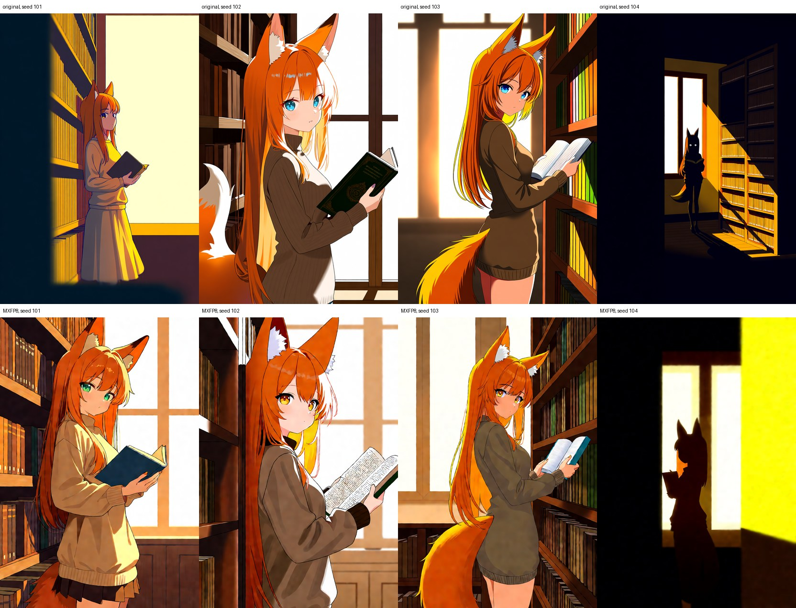
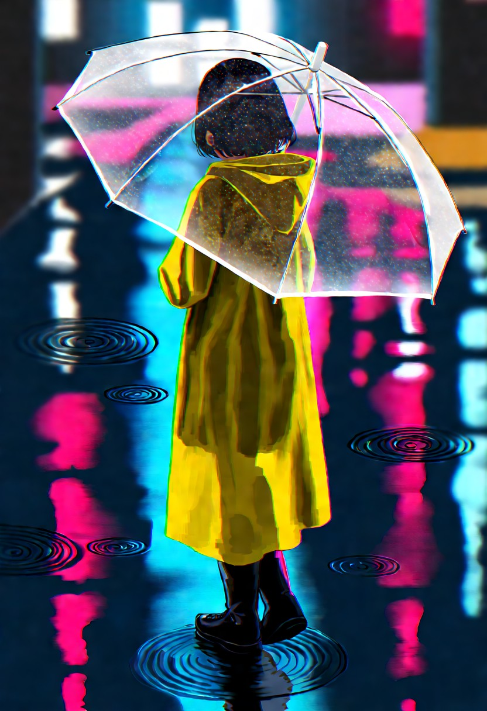

# Anima 3.8B v1.1 MXFP8

An MXFP8 copy of [lylogummy/Anima-3.8B](https://huggingface.co/lylogummy/Anima-3.8B) v1.1 for
ComfyUI. The file is 5.6 GB instead of 8.8 GB, and on an RTX 5080 it renders about 1.25 times
faster than the original under the settings below. It is the same bundle as the original (the
52-block DiT plus the bundled Semantic Connector v2) with only the large DiT projections
converted to 8-bit.

Non-commercial license. Not an official CircleStone Labs or lylogummy release.

**Download:** [Hugging Face](https://huggingface.co/kefallrain/Anima-3.8B-v1.1-MXFP8) and [Civitai](https://civitai.com/models/3015129/anima-38b-v11-mxfp8). The GitHub repository holds
the documentation, workflow, patch and bake script only, because GitHub caps release files at 2 GB.


## What was changed

- **Quantized to MXFP8:** the self-attention, cross-attention and MLP projection weights of all
  52 DiT blocks, 520 tensors in all (`net.blocks.N.{self_attn,cross_attn}.{q,k,v,output}_proj`
  and `net.blocks.N.mlp.layer1/2`). MXFP8 stores each value as FP8 E4M3 and keeps one E8M0
  scale per 32 values. The scales are stored as uint8 bytes, which is what ComfyUI's
  memory-mapped loader reads.
- **Unchanged (bf16):** `x_embedder`, `t_embedder`, `final_layer`, all norms, the adaLN
  modulation layers, `llm_adapter`, and the Semantic Connector v2 (`net.anima_v2_connector.*`,
  190 tensors). The upstream metadata is kept, so the `anima.3-8B-v2` loader lists the file.

| File | Bytes | SHA-256 |
|---|---|---|
| `Anima-3.8B-v1.1-mxfp8.safetensors` (this release) | 5,640,037,822 | `8ada9bc806fc65ebe81519a5696bc18329eb841d0bdf66fb5cc234114f02b940` |
| `difussion_models/Anima-3.8B-v1.1.safetensors` (source, upstream) | 8,809,227,318 | `4a458d26b21efa350073422f756d521b4397d9ca5964da4dc6bd9ae258a29629` |

## Requirements

- **GPU:** MXFP8 runs as native 8-bit matrix multiplies only on RTX 50-series (Blackwell) cards.
  According to ComfyUI's quantization documentation, other GPUs load the file but dequantize the
  weights, which gives the smaller download without the speedup. Only an RTX 5080 was tested.
- **ComfyUI:** tested with ComfyUI 0.42.1, comfy-kitchen 0.2.39, PyTorch 2.10 with CUDA 13.0.
- **Custom node:** [GumGum10/comfyui-anima-3-8B](https://github.com/GumGum10/comfyui-anima-3-8B)
  (tested at commit `381c13a`) **plus the patch below**.
- **Text encoders and VAE** (same as the original v1.1): `qwen_3_06b_base.safetensors`,
  `qwen35_4b.safetensors` and `qwen_image_vae.safetensors`. See the
  [upstream model card](https://huggingface.co/lylogummy/Anima-3.8B) for download links.

### Patch for the ComfyUI node

At commit `381c13a`, the `anima.3-8B-v2` loader fails on this checkpoint with
`AttributeError: 'Linear' object has no attribute 'weight'`. ComfyUI builds models stored in its
per-layer quantized format with mixed-precision operations, whose Linear layers get their weights
only when the state dict is loaded, and the node tries to initialize those weights before that.
The patch in
[`patches/comfyui-anima-3-8B-quantized-loader.diff`](patches/comfyui-anima-3-8B-quantized-loader.diff)
makes the node skip that initialization, as it already does for lazily loaded weights. For the
unquantized checkpoint the patched check gives the same result as before.

```bash
cd ComfyUI/custom_nodes/comfyui-anima-3-8B
git apply /path/to/comfyui-anima-3-8B-quantized-loader.diff
```

Restart ComfyUI afterwards.

## Usage

1. Put `Anima-3.8B-v1.1-mxfp8.safetensors` in `ComfyUI/models/diffusion_models/`.
2. Install and patch the custom node as above, then restart ComfyUI.
3. Load [`workflows/anima-3.8b-v1.1-mxfp8.json`](workflows/anima-3.8b-v1.1-mxfp8.json). It is the
   upstream `workflow_1.1.json` reduced to core nodes plus the two `anima.3-8B-v2` nodes.

The samples use 832×1216, 28 steps, CFG 7, `res_multistep` with the `beta` scheduler, no LoRA.
The upstream card recommends about one megapixel, CFG 4 to 7 and 28 to 50 steps.

## Speed

RTX 5080 16 GB, ComfyUI 0.42.1 with `--use-sage-attention --fast fp16_accumulation
--reserve-vram 2.5` and dynamic VRAM on. 832×1216, 28 steps, CFG 7, `res_multistep` / `beta`.
Time is ComfyUI's execution time per image, warm, including VAE decode; median of three seeds.
Both files were loaded through the same `anima.3-8B-v2` workflow; only the model file differed.

| Checkpoint | Size | Time per image |
|---|---|---|
| Anima 3.8B v1.1, original | 8.8 GB | 14.00 s |
| Anima 3.8B v1.1, MXFP8 (this) | 5.6 GB | 11.19 s (1.25×) |

With `--fast fp16_accumulation`, ComfyUI ran the original as fp16 weights with fp16
accumulation, the fastest baseline on GeForce cards. Without that flag the original runs in
bf16; that case was not measured here.

## Quality

The same seed does not reproduce the original image. 8-bit weights change the sampling path, so
pose and framing can differ. The comparison below uses the speed-test prompt with four seeds;
judge it for yourself.



<details>
<summary>Sample prompts</summary>

All samples: 832×1216, 28 steps, CFG 7, `res_multistep` / `beta`. Negative prompt:
`worst quality, low quality, bad hands, extra digits, missing fingers, jpeg artifacts, watermark, signature, text, nsfw`

| Image | Seed | Prompt |
|---|---|---|
| `01-library` | 42 | `safe, newest, year 2025, 1girl, solo, fox ears, long hair, orange hair, sweater, holding book, bookshelf, library, sunlight, looking at viewer` / Description: A fox-eared girl stands by a tall bookshelf in an old library, holding an open book. Warm afternoon light falls through the tall windows behind her. |
| `02-rain` | 1001 | `safe, newest, year 2025, 1girl, solo, short hair, black hair, yellow raincoat, holding umbrella, transparent umbrella, night, rain, city street, colorful lights, reflection, puddle` / Description: A girl in a yellow raincoat walks down a narrow city street at night under a transparent umbrella. Colored lights shimmer in the puddles on the wet pavement. |
| `03-sunflower` | 1002 | `safe, newest, year 2025, 1girl, solo, long hair, blonde hair, white dress, sun hat, sunflower field, blue sky, cumulonimbus cloud, summer, smile` / Description: A girl in a white sundress and a straw hat stands in a sunflower field under a bright summer sky with tall white clouds. |
| `04-mage` | 1004 | `safe, newest, year 2025, 1girl, solo, long hair, silver hair, elf, pointy ears, robe, holding staff, magic, glowing, forest, ruins, light particles` / Description: An elf mage with long silver hair raises a staff among forest ruins, soft magical light gathering at its tip and drifting around her. |
| `05-cafe` | 1005 | `safe, newest, year 2025, 1girl, solo, twintails, pink hair, cardigan, sitting, cafe, window, teacup, cake, indoors, daylight, smile, looking at viewer` / Description: A girl with pink twintails sits by a cafe window with a cup of tea and a slice of cake, smiling at the viewer in soft daylight. |

The tags and the description are one prompt, separated by a line break and `Description:`.
The speed test and the comparison use the `01-library` prompt with seeds 101 to 104.

</details>

| | | | |
|---|---|---|---|
|  |  |  |  |

## Reproducing the file

[`tools/bake_mxfp8.py`](tools/bake_mxfp8.py) rebuilds the file from the upstream checkpoint with
ComfyUI's own MXFP8 quantizer, then reloads the result the way the `anima.3-8B-v2` loader does
and checks the quantized layer set. Run it with the Python environment of your ComfyUI install:

```bash
python tools/bake_mxfp8.py --comfy /path/to/ComfyUI --require-native \
  Anima-3.8B-v1.1.safetensors Anima-3.8B-v1.1-mxfp8.safetensors
```

It prints the SHA-256 of the source and the output. The published file was made with ComfyUI
0.42.1 and comfy-kitchen 0.2.39 on an RTX 5080; other versions may produce different bytes.

## License

- **Model weights:** CircleStone Labs Non-Commercial License v1.2, in
  [`LICENSE-MODEL.md`](LICENSE-MODEL.md), with the attribution notice and modification statement
  in [`NOTICE`](NOTICE). Use of the model is limited to non-commercial purposes. The license allows
  generated images to be used for any purpose, including commercial ones, except where it says
  otherwise (section 2(e)). Rights are granted to you directly by CircleStone Labs LLC. Built on
  NVIDIA Cosmos.
- **Scripts, workflow, patch and documentation in this repository:** MIT, in [`LICENSE`](LICENSE).
  The patch modifies GumGum10/comfyui-anima-3-8B, which is also MIT licensed.

## Credits

- [CircleStone Labs](https://huggingface.co/circlestone-labs/Anima) for Anima.
- [lylogummy](https://huggingface.co/lylogummy/Anima-3.8B) for Anima 3.8B and the Semantic
  Connector v2.
- [GumGum10](https://github.com/GumGum10/comfyui-anima-3-8B) for the ComfyUI nodes.
- [ComfyUI](https://github.com/comfyanonymous/ComfyUI) and comfy-kitchen for the MXFP8 support.
